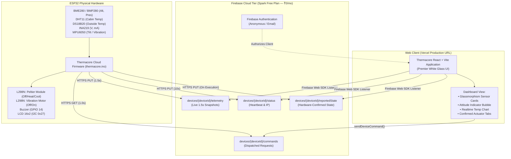

# Thermacore — Cloud IoT Telemetry & Thermal Control Platform

[](frontend/)
[](firebase/)
[](firmware/)
[](https://vercel.com)

**Thermacore** is an autonomous thermal and environmental telemetry platform. Originally designed with a local ESP32-hosted web server, this repository upgrades Thermacore into a secure, cloud-connected IoT application. 

You can now monitor live physical sensor telemetry and control Peltier cooling/heating and surface de-icing vibration actuators from **any browser, anywhere in the world**, without requiring local Wi-Fi port forwarding or static IP addresses.

---

## 1. System Architecture



---

## 2. Repository Structure

```
SihProject/
├── frontend/                     # React + Vite Cloud Dashboard
│   ├── src/
│   │   ├── components/           # Reusable UI (Header, Controls, SensorGrid, etc.)
│   │   ├── hooks/                # useDeviceTelemetry, useAuth
│   │   ├── lib/                  # firebase.js, database.js, auth.js
│   │   ├── pages/                # Dashboard.jsx
│   │   ├── styles/               # index.css (Premier White Glass Palette)
│   │   ├── App.jsx
│   │   └── main.jsx
│   ├── .env.example              # Public config template
│   ├── index.html
│   ├── package.json
│   ├── vite.config.js
│   └── README.md
│
├── firmware/
│   └── thermacore/
│       ├── thermacore.ino        # Compilable ESP32 Cloud Arduino Firmware
│       └── README.md             # Library list and upload guide
│
├── firmware_original/            # Original unmodified local web server firmware
│   └── thermacore_original.ino
│
├── firebase/
│   ├── database.rules.json       # Security & validation rules
│   ├── firebase.json             # CLI & Emulator config
│   └── README.md                 # Rules & testing guide
│
├── .gitignore                    # Prevents credentials & build files from git
└── README.md                     # Master documentation
```

---

## 3. Step-by-Step Setup Guide

### Step 1: Create a Free Firebase Project
1. Open the [Firebase Console](https://console.firebase.google.com/) and sign in with your Google account.
2. Click **Add project** -> Name it `thermacore-iot` (or your choice).
3. Disable Google Analytics (optional) -> Click **Create project**.
4. Once created, click on **Build -> Realtime Database** in the left sidebar:
   - Click **Create Database**.
   - Select the database location closest to you (e.g. `asia-southeast1` or `united-states`).
   - Choose **Start in test mode** for the initial setup.
   - Note down your database URL: `https://<YOUR-PROJECT-ID>-default-rtdb.firebaseio.com/`.
5. In the left sidebar, click **Build -> Authentication**:
   - Click **Get started**.
   - Under **Sign-in method**, enable **Anonymous** (or Email/Password).
6. Register a Web App in Firebase:
   - Click the gear icon next to Project Overview -> **Project settings**.
   - Scroll to **Your apps** -> Click the **Web** icon (`</>`).
   - App nickname: `thermacore-web` -> Click **Register app**.
   - Copy the `firebaseConfig` keys.

---

### Step 2: Configure and Run Frontend Locally
1. Navigate into the frontend folder:
   ```bash
   cd frontend
   ```
2. Create your local environment file:
   ```bash
   cp .env.example .env.local
   ```
3. Open `.env.local` and paste your Firebase Web credentials:
   ```ini
   VITE_FIREBASE_API_KEY=YOUR_FIREBASE_API_KEY
   VITE_FIREBASE_AUTH_DOMAIN=your-project-id.firebaseapp.com
   VITE_FIREBASE_DATABASE_URL=https://your-project-id-default-rtdb.firebaseio.com
   VITE_FIREBASE_PROJECT_ID=your-project-id
   VITE_FIREBASE_STORAGE_BUCKET=your-project-id.appspot.com
   VITE_FIREBASE_MESSAGING_SENDER_ID=YOUR_MESSAGING_SENDER_ID
   VITE_FIREBASE_APP_ID=YOUR_FIREBASE_APP_ID
   VITE_DEFAULT_DEVICE_ID=thermacore-esp32-01
   ```
4. Start the development server:
   ```bash
   npm run dev
   ```
5. Open `http://localhost:3000` in your browser. You will see the Thermacore Premier White Glass dashboard in "Connecting to Cloud..." state.

---

### Step 3: Configure and Flash ESP32 Firmware
1. Open `firmware/thermacore/thermacore.ino` in **Arduino IDE**.
2. Verify required libraries are installed (**Sketch -> Include Library -> Manage Libraries...**):
   - `ArduinoJson` (v6 or v7)
   - `LiquidCrystal_I2C`
   - `Adafruit BME280` / `Adafruit BMP280`
   - `Adafruit MPU6050`
   - `Adafruit INA219`
   - `DHT sensor library`
   - `DallasTemperature`
   - `OneWire`
3. Update the credentials at the top of `thermacore.ino`:
   ```cpp
   const char* WIFI_SSID     = "YOUR_WIFI_NAME";
   const char* WIFI_PASSWORD = "YOUR_WIFI_PASSWORD";
   const char* FIREBASE_HOST = "thermacore-iot-default-rtdb.firebaseio.com"; // Your database host without https://
   const char* DEVICE_ID     = "thermacore-esp32-01";
   ```
4. Select board: **Tools -> Board -> esp32 -> ESP32 Dev Module**.
5. Select your USB port: **Tools -> Port**.
6. Click **Upload**. (Hold the **BOOT** button on the ESP32 if `Connecting........_____` appears).
7. Open **Serial Monitor** at **115200 baud**.
8. Within seconds, the ESP32 connects to Wi-Fi and pushes live telemetry to Firebase.
9. Refresh your browser dashboard: the status indicator will immediately turn **🟢 Sensor Stream Live**, displaying live temperatures, altitude, battery readings, and attitude vector!

---

### Step 4: Deploy Frontend to Vercel
1. Push your repository to your private GitHub account:
   ```bash
   git add .
   git commit -m "feat: complete Thermacore cloud migration"
   git branch -M main
   git remote add origin https://github.com/<YOUR_USERNAME>/thermacore.git
   git push -u origin main
   ```
2. Go to [Vercel](https://vercel.com) and log in.
3. Click **Add New... -> Project** -> Import your `thermacore` repository.
4. Set the **Root Directory** to `frontend`.
5. Under **Environment Variables**, add the keys from your `.env.local`:
   - `VITE_FIREBASE_API_KEY`
   - `VITE_FIREBASE_AUTH_DOMAIN`
   - `VITE_FIREBASE_DATABASE_URL`
   - `VITE_FIREBASE_PROJECT_ID`
   - `VITE_FIREBASE_STORAGE_BUCKET`
   - `VITE_FIREBASE_MESSAGING_SENDER_ID`
   - `VITE_FIREBASE_APP_ID`
   - `VITE_DEFAULT_DEVICE_ID`
6. Click **Deploy**.
7. Vercel provides a live URL (e.g. `https://thermacore.vercel.app`). Open this on your mobile phone or any computer—it will stream your ESP32 hardware telemetry in real time!

---

## 4. Hardware Safety & Control Verification

### Actuator Control Cycle
1. When you click **HEAT 🔥**, **COOL ❄️**, or **OFF**, the frontend generates a unique `commandId` and writes to `devices/{deviceId}/commands`.
2. The UI button displays a glowing feedback status: `⏳ Awaiting ESP32 ACK...`.
3. The ESP32 receives the command on its non-blocking 1.0s poll, validates the parameters, updates the L298N pins (`IN1`, `IN2`, `ENA`), and displays the confirmation on the LCD.
4. The ESP32 writes to `devices/{deviceId}/reportedState`.
5. The frontend receives the acknowledgment and switches the button label to `✓ Confirmed by ESP32`.

### Thermal & Electrical Safety
- **L298N Interlock**: `IN1` and `IN2` are never energized in conflicting states. Mode `0` drives both `LOW` to prevent heating overshoot.
- **Fail-Safe Offline Mode**: If Wi-Fi is lost, the ESP32 keeps reading the MPU6050 accelerometer and sounds the buzzer locally if rough terrain is detected. Network disruptions do not blind the local safety systems.

---

## 5. Free-Tier Quota & Cost Analysis (₹0 / Month)

This architecture runs completely inside Firebase's **Spark Plan (Free Tier)**:

| Metric | Firebase Spark Quota | Thermacore Estimated Usage | Margin |
| :--- | :--- | :--- | :--- |
| **Simultaneous Connections** | 100 connections | 2 (1 ESP32 + 1 Dashboard) | **98% free** |
| **Data Stored** | 1.0 GB | < 50 KB (latest snapshots overwrite) | **>99.9% free** |
| **Download Bandwidth** | 10 GB / month | ~300 MB / month (1.5s interval) | **97% free** |
| **Vercel Hosting** | 100 GB bandwidth | < 1 GB / month | **99% free** |

No credit card or paid billing is required.
